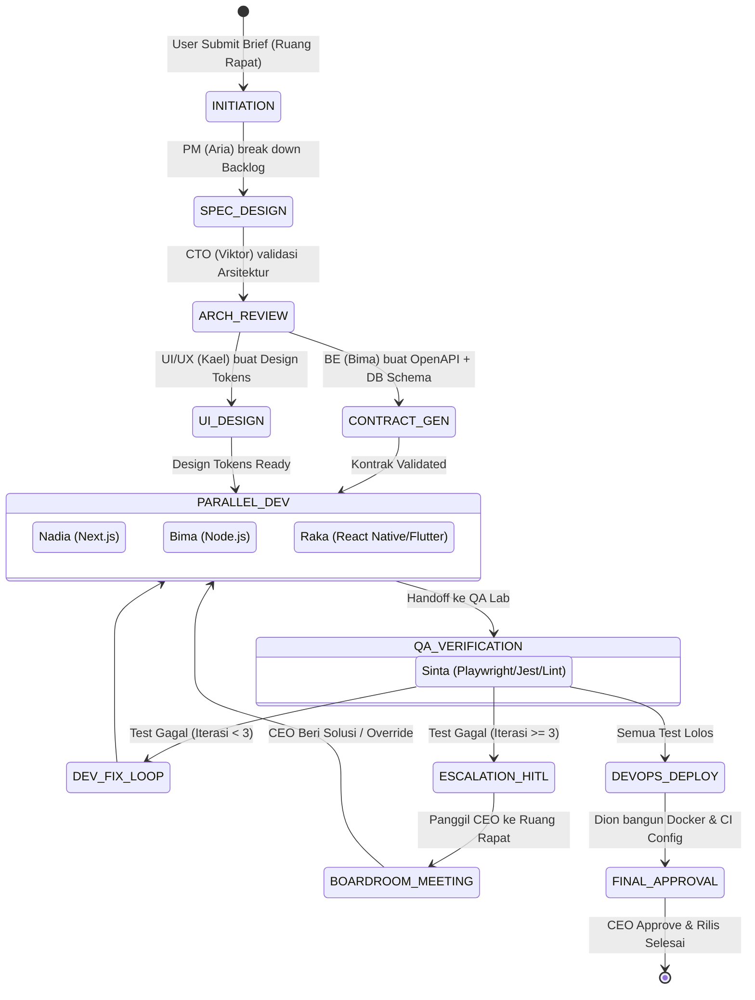
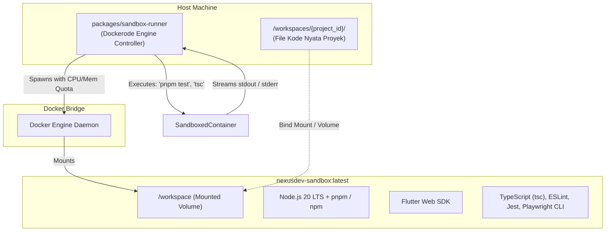

# Dokumen Spesifikasi Arsitektur Teknis (System Architecture & Tech Stack Spec)
## NexusDev Virtual Studio — 2D Interactive Multi-Agent AI Software House

**Versi Dokumen:** 1.0  
**Tanggal:** 15 Oktober 2026  
**Status:** Approved based on Confirmed Intent  
**Basis Acuan:** Business Requirements Document (BRD) v1.0  

---

## 1. Ringkasan Eksekutif & Prinsip Desain Teknis

NexusDev Virtual Studio adalah platform kantor virtual 2D interaktif berbasis Web yang mengorkestrasi tim agen kecerdasan buatan (*Multi-Agent AI*) untuk menjalankan siklus hidup rekayasa perangkat lunak (*Software Development Life Cycle* / SDLC) secara otonom dan kolaboratif. Platform ini melayani produksi aplikasi **Web modern (Next.js, Node.js)** serta aplikasi **Mobile (Android & iOS melalui React Native/Expo dan Flutter)**.

### Prinsip Fondasi Arsitektur (Core Architectural Principles)
1. **Unified Full-Stack TypeScript:** Seluruh lapisan sistem—dari antarmuka Web, canvas 2D Phaser.js, backend gateway, hingga orkestrasi agen AI—dibangun menggunakan ekosistem TypeScript murni dalam arsitektur Monorepo untuk memastikan konsistensi tipe (*end-to-end type safety*).
2. **Decoupled 2D Spatial & Business State:** Game engine 2D (Phaser.js) bertindak sebagai *view layer* spasial, sementara state bisnis, antrian tugas, dan siklus agen dikelola secara terpusat oleh Server Orchestrator melalui event-driven WebSockets.
3. **Isolated & Safe Execution Sandboxing:** Seluruh proses kompilasi kode, *linting*, pengujian otomatis, dan *build* dieksekusi di dalam kontainer Docker terisolasi (*ephemeral volume mounting*) untuk melindungi sistem *host*.
4. **Deterministic Human-in-the-Loop (HITL):** Tahapan kritis (persetujuan arsitektur, migrasi skema database, rilis *production*, serta penanganan *bug loop* > 3 kali) memiliki mekanisme jeda (*interruption*) otomatis yang mewajibkan validasi manusia (*Human CEO*).
5. **Multi-Model LLM Abstraction (BYOK):** Mesin agen dirancang agnostik terhadap penyedia LLM melalui pola *Adapter Pattern*, dengan Google Gemini (Gemini 2.0 Flash / 1.5 Pro) sebagai mesin utama untuk throughput cepat dan context window besar, didukung Claude 3.5 Sonnet dan OpenAI GPT-4o.

---

## 2. Struktur Monorepo & Batasan Modul (Repository Layout)

Sistem menggunakan **Turborepo** dengan manajer paket **pnpm** (atau npm workspaces) untuk mengelola dependensi bersama dan *build pipeline* yang efisien.

```
virtual-office/
├── apps/
│   ├── web/                        # Next.js 15 (App Router, Tailwind CSS, Lucide UI)
│   │   ├── src/
│   │   │   ├── app/                # Route handlers, dashboard & studio pages
│   │   │   ├── components/         # React UI Overlays (Kanban, Chat, Inspector, Modals)
│   │   │   ├── phaser/             # Phaser 3 Game Engine Integration
│   │   │   │   ├── scenes/         # OfficeScene, MeetingScene, LoadingScene
│   │   │   │   ├── entities/       # Player (CEO), AgentAvatar, Desk, RoomZone
│   │   │   │   ├── systems/        # A* Pathfinding, ProximityDetector, Camera
│   │   │   │   └── assets/         # Tilemaps (JSON), Spritesheets, SFX
│   │   │   └── hooks/              # useSocket, useAgentState, useProject
│   │   ├── package.json
│   │   └── tsconfig.json
│   │
│   └── server/                     # NestJS / Fastify Backend Application
│       ├── src/
│       │   ├── modules/
│       │   │   ├── agent/          # Agent Lifecycle & Orchestration Gateway
│       │   │   ├── project/        # Project & Workspace Management
│       │   │   ├── socket/         # WebSocket Gateway (Socket.io)
│       │   │   ├── sandbox/        # Docker Sandbox Execution Controller
│       │   │   └── llm/            # LLM Provider Adapters (Gemini, Anthropic, OpenAI)
│       │   ├── main.ts
│       │   └── app.module.ts
│       ├── package.json
│       └── tsconfig.json
│
├── packages/
│   ├── agent-orchestrator/         # State-Machine & LangGraph.js Agent Engine
│   │   ├── src/
│   │   │   ├── graph/              # SDLC Workflow State Machine
│   │   │   ├── roles/              # System Prompts & Skill definitions (8 Roles)
│   │   │   ├── tools/              # Agent Tool implementations (FS, Git, Test, Lint)
│   │   │   └── memory/             # Short-term context & Long-term project memory
│   │   └── package.json
│   │
│   ├── sandbox-runner/             # Docker Sandbox Runner & Toolchain Drivers
│   │   ├── src/
│   │   │   ├── docker.service.ts   # Dockerode wrapper, container spawner, volume mounter
│   │   │   ├── security.ts         # Command whitelist & timeout watchdog
│   │   │   └── templates/          # Base Dockerfiles (Node 20, Python, Flutter Web)
│   │   └── package.json
│   │
│   ├── shared/                     # Shared Types, Zod Schemas & Event Contracts
│   │   ├── src/
│   │   │   ├── types/              # Agent, Project, Task, Spatial, Message types
│   │   │   ├── schemas/            # Zod validation schemas (OpenAPI, Tool inputs)
│   │   │   └── events/             # WebSocket event definitions
│   │   └── package.json
│   │
│   └── database/                   # Database Client & Migration (Prisma ORM)
│       ├── prisma/
│       │   └── schema.prisma       # Schema definition (Postgres / SQLite)
│       ├── src/
│       │   └── index.ts            # Prisma client instance
│       └── package.json
│
├── workspaces/                     # Isolated project repositories generated by agents
│   └── .gitkeep
├── docs/                           # Dokumentasi Arsitektur & Intent
│   ├── SYSTEM_ARCHITECTURE_SPEC.md
│   └── intent/
├── turbo.json                      # Turborepo Pipeline Config
├── package.json                    # Root package.json
└── pnpm-workspace.yaml             # Workspace definitions
```

---

## 3. Arsitektur Engine Spasial 2D (Phaser.js + Next.js Overlay)

Antarmuka kantor virtual memadukan rendering grafis 2D berkinerja tinggi (*WebGL / Canvas*) dengan fleksibilitas antarmuka pengguna Web modern (*DOM / Tailwind CSS*).

```mermaid
graph LR
    subgraph Browser Client (Next.js 15)
        P[Phaser 3 Canvas Container] -->|Emits Events: click, proximity, arrived| Bridge[Event Bridge Hook]
        Bridge -->|Triggers UI| R[React DOM Overlay]
        R -->|Drawers, Kanban, Meeting Modal| User[Human CEO]
        User -->|WASD / Click Nav| Bridge
        Bridge -->|Move Commands| P
    end
    Bridge <-->|WebSocket bi-directional| S[NestJS Gateway Server]
```

### 3.1 Pembagian Zona Denah Kantor (Tilemap Spec)
Kantor virtual dirancang menggunakan peta berbasis *tile* (ukuran grid $32 \times 32$ piksel) dengan pembagian ruangan tematik:
1. **Boardroom / Ruang Rapat Utama (Area Rapat & HITL):** Tempat seluruh agen berkumpul ketika proyek dimulai, saat evaluasi sprint, atau saat terjadi eskalasi persetujuan pengguna.
2. **Product & Design Studio (Meja `AGT-PM` & `AGT-UIUX`):** Dilengkapi papan catatan visual (*whiteboard*), tempat perancangan *User Stories* dan *Design Tokens*.
3. **Engineering Bay — Web (Meja `AGT-FE` & `AGT-BE`):** Area penulisan kode Next.js dan backend Node.js. Meja dilengkapi indikator status editor kode.
4. **Engineering Bay — Mobile (Meja `AGT-MOB`):** Area perancangan aplikasi React Native / Flutter dengan monitor simulasi mobile.
5. **Quality Assurance Lab (Meja `AGT-QA`):** Dilengkapi konsol uji otomatis (*Playwright / Test Runner*) dan lampu indikator status *Pass/Fail*.
6. **DevOps & Cloud Server Room (Meja `AGT-OPS`):** Ruangan berdesain *datacenter rack* tempat agen mengelola Docker, pipeline CI/CD, dan URL *deployment*.
7. **CEO Executive Desk (Meja `USR-CEO`):** Titik awal (*spawn point*) avatar pengguna dengan akses langsung ke seluruh ruangan.

### 3.2 Sistem Navigasi & Karakter (Movement & Pathfinding)
- **A\* Pathfinding Algorithm:** Menggunakan library `easystarjs` yang diintegrasikan ke Phaser 3. Ketika pengguna atau agen diberi target koordinat $(x, y)$, rute terpendek dihitung tanpa menabrak dinding atau furnitur (*collision layer*).
- **Proximity Zones:** Setiap meja agen memiliki lingkaran sensor deteksi radius 64px. Ketika avatar CEO memasuki zona ini, *bubble action* "Ajak Bicara" muncul di atas kepala agen.
- **State Animasi Sprite:**
  - `IDLE`: Karakter menghadap depan/samping dengan animasi napas santai.
  - `WALK`: Animasi 4 arah (atas, bawah, kiri, kanan) dengan sinkronisasi kecepatan gerak.
  - `TYPING / WORKING`: Karakter duduk di meja dengan animasi mengetik keyboard dan layar monitor menyala.
  - `MEETING / TALKING`: Karakter berdiri di ruang rapat dengan balon dialog mini (*speech bubble*) menampilkan ringkasan aktivitas terkini.

---

## 4. Arsitektur Orkestrasi Multi-Agent (Graph State Machine)

Siklus kerja agen diatur menggunakan *state machine* terarah berbasis **LangGraph.js / State Graph Engine** untuk menjamin alur kerja terstruktur, deterministik, dan dapat dipulihkan (*checkpointing*).



### 4.1 Matriks Peran & Prompt Spesialisasi

| ID Peran | Nama Agen | Tanggung Jawab Teknis | Tools yang Dapat Diakses | Output Artefak |
| :--- | :--- | :--- | :--- | :--- |
| `AGT-CTO` | **Viktor** | Arsitektur sistem, review keamanan & PR | `read_code`, `review_diff`, `validate_openapi` | `ARCH_DECISION.md`, PR Review Approval |
| `AGT-PM` | **Aria** | Dekomposisi tugas, sprint backlog, eskalasi | `create_task`, `update_kanban`, `call_meeting` | `BACKLOG.json`, `SPRINT_PLAN.md` |
| `AGT-UIUX` | **Kael** | Design token, struktur komponen UI | `export_tokens`, `write_design_spec` | `tokens.json`, `UI_SPEC.md` |
| `AGT-FE` | **Nadia** | Web Next.js 15, React, Tailwind CSS | `write_code`, `run_lint`, `type_check` | Source code `apps/web/` |
| `AGT-BE` | **Bima** | Node.js, NestJS, Postgres, OpenAPI | `write_code`, `prisma_migrate`, `generate_openapi` | Source code `apps/server/`, `openapi.yaml` |
| `AGT-MOB` | **Raka** | React Native (Expo) & Flutter Web | `write_code`, `expo_doctor`, `flutter_analyze` | Source code `apps/mobile/` |
| `AGT-QA` | **Sinta** | Automated test, bug report, verification | `run_jest`, `run_playwright`, `report_bug` | `TEST_REPORT.json`, Bug Tickets |
| `AGT-OPS` | **Dion** | Dockerfile, GitHub Actions, CI/CD | `generate_dockerfile`, `setup_ci_pipeline` | `Dockerfile`, `.github/workflows/` |

### 4.2 Circuit Breaker Anti-Loop Tak Hingga
Untuk mencegah agen QA dan Developer terjebak dalam siklus perbaikan tanpa henti (*infinite loop* token drain):
$$\text{IterationCount}_{\text{task}} \le 3$$
- Jika $\text{IterationCount} < 3$: Tiket bug dialihkan kembali ke agen pengembang terkait dengan konteks log error spesifik.
- Jika $\text{IterationCount} = 3$ dan error masih terjadi: State machine otomatis berpindah ke `ESCALATION_HITL`. Sistem mengirim notifikasi mendesak ke layar CEO, agen bergerak menuju Ruang Rapat, dan modal diskusi dibuka meminta arahan pengguna.

---

## 5. Arsitektur Sandbox & Eksekusi Lingkungan (Docker Runners)

Setiap proyek yang dibuat oleh pengguna di NexusDev Virtual Studio memiliki ruang kerja (*workspace*) terisolasi yang dieksekusi di dalam kontainer Docker pengembang.



### Parameter Keamanan Sandbox:
1. **Resource Limits:** Pembatasan memori maksimum 2048 MB dan CPU 2 core per kontainer proyek untuk mencegah konsumsi sumber daya berlebih.
2. **Command Whitelisting:** Sandbox hanya mengizinkan eksekusi toolchain resmi (`npm`, `pnpm`, `npx`, `tsc`, `eslint`, `jest`, `playwright`, `flutter analyze`). Perintah berbahaya (`rm -rf /`, `curl | sh`, dll.) otomatis diblokir oleh layer filter keamanan.
3. **Execution Timeout:** Batas waktu eksekusi skrip maksimum 120 detik per eksekusi perintah untuk menangani proses yang menggantung.

---

## 6. Strategi Pratinjau Cepat Aplikasi Mobile (Expo & Flutter Web)

Kompilasi aplikasi mobile Android (`.apk`/`.aab`) dan iOS (`.ipa`) membutuhkan toolchain berat (Android SDK > 15 GB, Xcode > 40 GB dan khusus macOS). Untuk menghadirkan pengalaman responsif di Virtual Office:

1. **Live Browser Web-Preview:**
   - **React Native:** Menggunakan **Expo SDK** yang mendukung kompilasi web secara langsung. Agen menjalankan `npx expo export:web` di sandbox, lalu server menyajikan hasilnya ke dalam komponen *Inspector Drawer* via `<iframe>` berbingkai *smartphone mockup*.
   - **Flutter:** Agen mengompilasi mode `flutter build web`, disajikan langsung dalam pratinjau interaktif.
2. **Automated CI/CD Native Bundler:**
   - **DevOps Agent (`AGT-OPS`)** menghasilkan konfigurasi **GitHub Actions** dan **Fastlane** / **EAS Build** (`eas.json`).
   - Ketika proyek disetujui untuk rilis, pipeline cloud yang sesungguhnya akan melakukan kompilasi biner native tanpa membebani mesin lokal pengguna.

---

## 7. Protokol Komunikasi Real-Time (WebSocket Event Contracts)

Komunikasi antara antarmuka Next.js/Phaser dengan backend orkestrator menggunakan **Socket.io** dengan payload bertipe ketat (*type-safe*).

### 7.1 Daftar Event Spasial & Agen (Client $\leftrightarrow$ Server)

| Nama Event | Arah | Payload Data Utama | Deskripsi |
| :--- | :--- | :--- | :--- |
| `player:move` | Client $\rightarrow$ Server | `{ x: number, y: number, direction: string }` | Sinkronisasi posisi avatar CEO |
| `agent:status_changed` | Server $\rightarrow$ Client | `{ agentId: string, state: AgentState, currentTask: string, room: string }` | Update status & animasi agen di peta 2D |
| `agent:navigated` | Server $\rightarrow$ Client | `{ agentId: string, targetX: number, targetY: number }` | Perintah jalan agen ke ruangan lain |
| `meeting:called` | Server $\rightarrow$ Client | `{ meetingId: string, topic: string, requiredAgents: string[] }` | Mengumpulkan agen di Ruang Rapat visual |
| `hitl:approval_requested` | Server $\rightarrow$ Client | `{ approvalId: string, type: 'ARCH' \| 'RELEASE' \| 'BUG_ESCALATION', payload: any }` | Menampilkan Modal Persetujuan ke CEO |
| `hitl:decision_submitted` | Client $\rightarrow$ Server | `{ approvalId: string, decision: 'APPROVE' \| 'REJECT', feedback?: string }` | Respon keputusan CEO terhadap permintaan persetujuan |
| `agent:speech_bubble` | Server $\rightarrow$ Client | `{ agentId: string, message: string, durationMs: number }` | Memunculkan bubble teks pendek di atas sprite agen |

---

## 8. Skema Basis Data Terpadu (Prisma Data Model)

Penyimpanan persisten state proyek, log agen, sesi rapat, dan riwayat kode dikelola menggunakan Prisma ORM.

```prisma
datasource db {
  provider = "postgresql" // Mendukung SQLite untuk local dev tanpa setup Docker DB
  url      = env("DATABASE_URL")
}

generator client {
  provider = "prisma-client-js"
}

model Project {
  id          String       @id @default(uuid())
  name        String
  description String
  status      String       // PLANNING, IN_PROGRESS, TESTING, COMPLETED, PAUSED
  platform    String       // WEB, MOBILE, FULLSTACK
  createdAt   DateTime     @default(now())
  updatedAt   DateTime     @updatedAt

  tasks       Task[]
  artifacts   Artifact[]
  meetings    MeetingSession[]
  approvals   ApprovalGate[]
  agentLogs   AgentLog[]
}

model Task {
  id          String       @id @default(uuid())
  projectId   String
  title       String
  description String
  assignee    String       // AGT-FE, AGT-BE, AGT-MOB, etc.
  status      String       // TODO, IN_PROGRESS, IN_REVIEW, DONE, ESCALATED
  priority    String       // LOW, MEDIUM, HIGH, CRITICAL
  iteration   Int          @default(0) // Anti-loop counter
  createdAt   DateTime     @default(now())
  updatedAt   DateTime     @updatedAt

  project     Project      @relation(fields: [projectId], references: [id], onDelete: Cascade)
}

model Artifact {
  id          String       @id @default(uuid())
  projectId   String
  name        String
  type        String       // SPEC, CODE, DESIGN_TOKEN, TEST_REPORT, DOCKERFILE
  filePath    String
  content     String?      // Inline preview untuk dokumen markdown / config
  createdAt   DateTime     @default(now())

  project     Project      @relation(fields: [projectId], references: [id], onDelete: Cascade)
}

model MeetingSession {
  id          String       @id @default(uuid())
  projectId   String
  topic       String
  summary     String?
  transcript  Json         // Array percakapan antar-agen dan CEO
  status      String       // ACTIVE, CONCLUDED
  createdAt   DateTime     @default(now())

  project     Project      @relation(fields: [projectId], references: [id], onDelete: Cascade)
}

model ApprovalGate {
  id          String       @id @default(uuid())
  projectId   String
  type        String       // ARCHITECTURE, STAGING_DEPLOY, BUG_OVERRIDE
  description String
  diffPayload Json?
  status      String       // PENDING, APPROVED, REJECTED
  feedback    String?
  createdAt   DateTime     @default(now())
  resolvedAt  DateTime?

  project     Project      @relation(fields: [projectId], references: [id], onDelete: Cascade)
}

model AgentLog {
  id          String       @id @default(uuid())
  projectId   String
  agentId     String
  level       String       // INFO, WARN, ERROR, DEBUG
  action      String
  message     String
  metadata    Json?
  createdAt   DateTime     @default(now())

  project     Project      @relation(fields: [projectId], references: [id], onDelete: Cascade)
}
```

---

## 9. Rencana Eksekusi Bertahap (Phased Implementation Roadmap)

Implementasi NexusDev Virtual Studio dibagi menjadi 4 tahap terukur:

### Tahap 1: Monorepo Foundation & Core 2D Office Canvas (MVP Sisi Depan)
- Inisialisasi Monorepo (Turborepo + pnpm workspaces).
- Setup `apps/web` (Next.js 15, Tailwind, shadcn/ui components).
- Integrasi Phaser 3 di dalam React: Render denah kantor 2D (Tilemap $32 \times 32$), avatar CEO dengan kontrol WASD/klik jalan, serta penempatan sprite 7 agen di meja masing-masing.
- Pembuatan UI Overlay: Inspector Drawer ketika agen diklik, Papan Kanban proyek, dan HUD navigasi cepat.

### Tahap 2: Backend Orchestrator & Multi-Agent State Machine
- Setup `apps/server` (NestJS dengan WebSocket Gateway Socket.io).
- Setup `packages/shared` (event contract & types) dan `packages/database` (Prisma ORM).
- Implementasi `packages/agent-orchestrator`: Integrasi Google Gemini 2.0/1.5 API Adapter dan konfigurasi prompt 8 agen (CTO, PM, UI/UX, FE, BE, Mobile, QA, DevOps).
- Integrasi alur Ruang Rapat: Input brief proyek $\rightarrow$ PM & CTO memecah backlog $\rightarrow$ sinkronisasi pergerakan agen ke ruang rapat.

### Tahap 3: Sandbox Code Execution & Docker Integration
- Implementasi `packages/sandbox-runner`: Driver Dockerode untuk membuat kontainer workspace terisolasi di `/workspaces/{project_id}`.
- Tool eksekusi untuk agen pengembang: `write_code`, `run_lint`, `type_check`, dan pengujian otomatis via QA Agent.
- Penambahan sirkuit *Anti-Loop* ($\le 3$ kali) dan mekanisme eskalasi HITL ke Ruang Rapat.

### Tahap 4: Mobile Pipeline (Expo/Flutter Web) & DevOps Deployment
- Integrasi modul pratinjau mobile (Expo Web di dalam *phone mockup iframe* pada Inspector Drawer).
- Generator konfigurasi CI/CD (GitHub Actions, Fastlane, Docker Compose) oleh DevOps Agent.
- Pengujian menyeluruh (*End-to-End verification*) alur pembuatan aplikasi dari brief hingga kode fungsional.

---

## 10. Konfirmasi Kesiapan Eksekusi

Spesifikasi arsitektur ini telah mengunci seluruh keputusan teknis, batasan dependensi, dan model interaksi yang dibutuhkan untuk membangun **NexusDev Virtual Studio**. Tahap selanjutnya adalah memulai **Tahap 1 (Monorepo Foundation & Core 2D Office Canvas)**.
